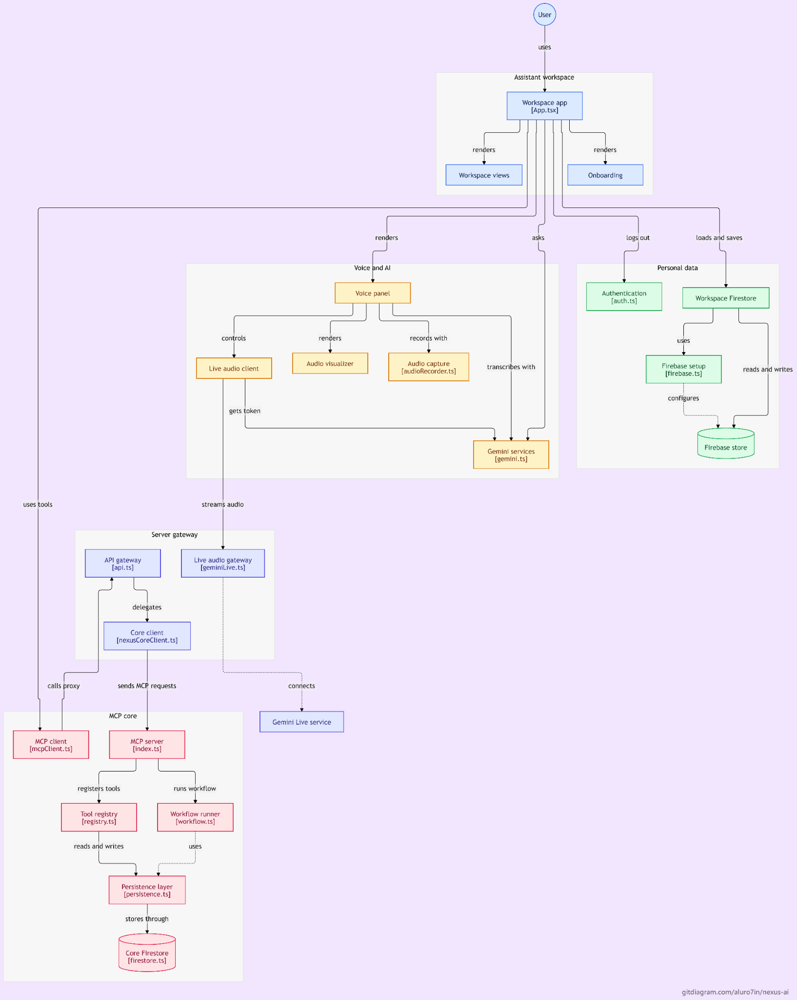
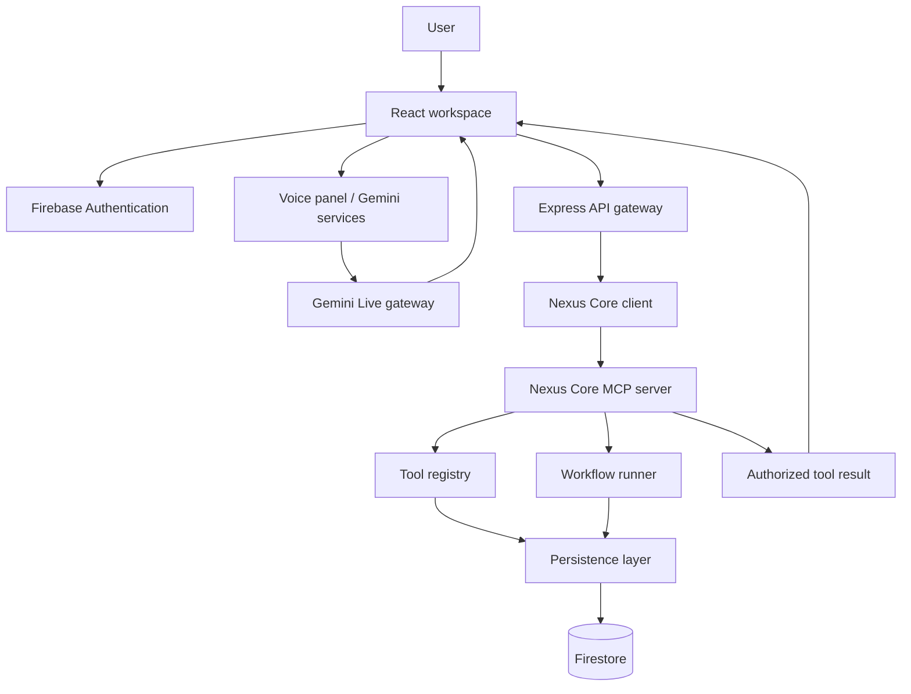

<div align="center">
  <h1>NEXUS AI</h1>
  <p><strong>An ambient AI workspace for voice-driven assistance, contextual workflows, and MCP-powered actions.</strong></p>
  <p>
    <a href="https://github.com/Aluro7in/Nexus-Ai"></a>
    <a href="https://nexus-ai-murex-one.vercel.app"></a>
    <a href="https://nexus-core-v4j3.onrender.com/health"></a>
  </p>
  <p>
    
    
    
    
    
    
    
    
    
  </p>
  <p><em>One workspace. Natural interaction. Explicitly governed actions.</em></p>
</div>

---

## Overview

**Nexus AI** is an ambient assistant workspace designed to bring conversational AI, voice interaction, personal context, and tool-driven workflows into one application.

The workspace combines a React interface, Gemini-powered AI services, Firebase authentication and persistence, and a dedicated **Nexus Core** service that exposes tools through the Model Context Protocol (MCP). The goal is to let a user express an intention naturally, let the AI interpret and coordinate the required steps, and route approved actions to the appropriate tools while keeping user identity and application data separated.

Nexus is designed as a modular system rather than a single chatbot. The user experience, voice layer, API gateway, MCP runtime, tool registry, workflow runner, and persistence layer have distinct responsibilities.

> **Project status:** The frontend and Nexus Core have live deployments. The backend health endpoint and Firestore adapter have been observed running successfully. Individual third-party integrations and external OAuth compatibility must still be validated independently; a tool appearing in the catalog does not by itself prove that its provider account is connected.

## Live links

| Component | URL | Purpose |
|---|---|---|
| Nexus AI workspace | [nexus-ai-murex-one.vercel.app](https://nexus-ai-murex-one.vercel.app) | Hosted web application |
| Nexus Core health | [GET `/health`](https://nexus-core-v4j3.onrender.com/health) | Service health response |
| Nexus Core status | [GET `/api/nexus/status`](https://nexus-core-v4j3.onrender.com/api/nexus/status) | Backend status and published tool catalog |
| MCP endpoint | `https://nexus-core-v4j3.onrender.com/mcp` | MCP Streamable HTTP endpoint |
| MCP relay | `https://nexus-core-v4j3.onrender.com/api/nexus/mcp-relay` | Server-side MCP relay route |

## Contents

- [Product capabilities](#product-capabilities)
- [Architecture](#architecture)
- [Technology stack](#technology-stack)
- [MCP tool catalog](#mcp-tool-catalog)
- [Request lifecycle](#request-lifecycle)
- [Security model](#security-model)
- [Repository layout](#repository-layout)
- [Getting started](#getting-started)
- [Configuration](#configuration)
- [Run, test, and build](#run-test-and-build)
- [Deployment](#deployment)
- [Current limitations](#current-limitations)
- [Roadmap](#roadmap)
- [Contributing](#contributing)
- [License](#license)

## Product capabilities

### Assistant workspace

- A unified workspace entry point built around the main application shell.
- Dedicated workspace views and an onboarding flow.
- A modular layout intended to support conversations, tasks, workflows, integrations, memory, and settings as the product evolves.

### Voice and AI

- A voice panel that coordinates voice interaction and AI responses.
- Audio capture through the audio recorder module.
- Audio visualization for live interaction feedback.
- Gemini-backed AI services for assistant responses.
- A live-audio gateway using WebSockets to connect the application server to the Gemini Live service.

### MCP tools and workflows

- A separate Nexus Core MCP server.
- A tool registry that describes available tools and their permission levels.
- A workflow runner for coordinating tool operations.
- A persistence layer backed by Firestore.
- Guarded and approval-required tool categories for actions that should not be treated like ordinary read operations.

### Identity and personal data

- Firebase Authentication for user identity.
- Firestore-backed workspace persistence.
- Backend-side token verification and user-scoped access to protected operations.
- Server-side handling for privileged credentials and upstream service calls.

## Architecture

The diagram below is the project architecture reference supplied with this repository. It shows the workspace, voice and AI layer, server gateway, MCP core, authentication, and persistence components and how they communicate.

<p align="center">
  
</p>

<details>
  <summary><strong>Architecture layers</strong></summary>

  | Layer | Main modules | Responsibility |
  |---|---|---|
  | Workspace | `App.tsx`, workspace views, onboarding | Application shell, navigation, and user-facing experience |
  | Voice and AI | Voice panel, `AudioRecorder.ts`, `gemini.ts`, `geminiLive.ts` | Audio capture, visualization, Gemini requests, and live audio transport |
  | Server gateway | `api.ts`, `nexusCoreClient.ts`, `geminiLive.ts` | API routing, backend communication, and WebSocket handling |
  | MCP core | `index.ts`, `registry.ts`, `workflow.ts`, `persistence.ts` | MCP server, tool registration, workflow execution, and persistence coordination |
  | Identity and data | `auth.ts`, `firebase.ts`, Firestore adapter | Identity verification, Firebase initialization, and durable data storage |

</details>

### Simplified interaction flow



## Technology stack

<p align="center">
  
</p>

| Area | Technologies | Role in Nexus |
|---|---|---|
| Frontend | React, TypeScript, Vite | Workspace application and client-side interactions |
| Styling and interface | Tailwind CSS, Lucide React, Motion | Styling, icons, and interface animation |
| Application server | Node.js, Express | API routes, application hosting, and server-side orchestration |
| AI | Google Gemini API, Gemini Live, `@google/genai` | Assistant intelligence and live audio interaction |
| Realtime transport | WebSocket (`ws`) | Live audio transport between the app server and Gemini Live |
| Identity | Firebase Authentication, Firebase Admin | Client sign-in and server-side identity verification |
| Data | Cloud Firestore | Workspace and MCP persistence |
| Agent/tool protocol | Model Context Protocol (MCP), Streamable HTTP | Tool discovery and structured tool invocation |
| Deployment | Vercel, Render, Docker | Frontend hosting and backend service deployment |

## MCP tool catalog

The deployed Nexus Core status endpoint has reported the following tool names and permission labels:

| Tool | Category | Permission | Intended operation |
|---|---|---|---|
| `workspace.calendar.list_events` | Productivity | `read` | Read calendar events |
| `workspace.gmail.summarize_threads` | Communication | `read` | Summarize email threads |
| `workspace.tasks.create` | Productivity | `write_guarded` | Create a task through a guarded write operation |
| `smarthome.scenes.activate` | IoT | `execute` | Activate a registered smart-home scene |
| `commerce.cart.prepare_checkout` | Commerce | `approval_required` | Prepare checkout for an explicit approval step |
| `nexus_get_context` | Context | `read` | Read the user's available Nexus context |
| `nexus_confirm_action` | Safety | `execute` | Confirm an action that requires confirmation |

**Integration note:** This is the tool catalog reported by Nexus Core. Actual execution depends on provider credentials, user authorization, tool configuration, and service availability. Read, write, execute, and approval-required operations should remain distinct in both the UI and backend authorization logic.

## Request lifecycle

1. The user interacts with the workspace or voice panel.
2. Firebase Authentication establishes the signed-in user identity.
3. The application server receives the request and routes it to the relevant service.
4. For MCP operations, the Nexus Core client sends a JSON-RPC request over the Streamable HTTP endpoint.
5. Nexus Core verifies the caller's accepted authentication token and derives the user identity from the verified credential.
6. The MCP server dispatches the request through the tool registry and, where applicable, the workflow runner.
7. Authorized operations read or write through the persistence layer and Firestore.
8. The result returns through the gateway to the workspace, where the assistant can present the outcome.

## Security model

Nexus is designed around authenticated identity, per-user data boundaries, and explicit handling of consequential actions.

- **Firebase identity:** The current Nexus Core implementation verifies Firebase ID tokens with Firebase Admin. A Firebase service-account private key is not a user access token.
- **User-scoped authorization:** Protected operations should use the UID from the verified token, not a UID supplied by the browser.
- **Server-side secrets:** Gemini keys, Firebase service-account credentials, and other privileged values must remain in server-side environment configuration or the hosting provider's secret manager.
- **No client-side privileged tokens:** Do not put service-account JSON, long-lived service credentials, or private API keys in Vite-exposed variables or browser bundles.
- **Action controls:** Preserve the distinction between read operations, guarded writes, execution, and approval-required actions. Require explicit user confirmation wherever the tool contract requires it.
- **Origin controls:** Configure the backend allowlist for the actual deployed frontend origin. Do not use permissive wildcard CORS together with credentials.
- **Production defaults:** Keep development authentication bypasses disabled in production and use Firestore persistence rather than an in-memory fallback.

### External MCP clients and OAuth status

The Nexus Core MCP endpoint is available at:

```text
https://nexus-core-v4j3.onrender.com/mcp
```

The current backend authentication implementation accepts verified Firebase ID tokens. The code audit performed during integration work found that the backend advertises protected-resource metadata but does **not** currently implement its own `/oauth/authorize` and `/oauth/token` endpoints. Therefore, do not describe direct Claude, Alexa+, or other third-party OAuth account linking as complete until a compatible authorization server or identity bridge has been implemented and tested.

For the signed-in Nexus web application, obtain a fresh Firebase ID token from the authenticated user and pass it through the trusted server-side proxy to Nexus Core. Do not replace per-user identity with a single static token in a multi-user application.

## Repository layout

The repository is organized around the workspace, gateway, and separately deployable Nexus services. Key top-level areas include:

```text
Nexus-Ai/
├── docs/                 # Project documentation and architecture assets
├── nexus-core/           # Nexus Core MCP backend
├── nexus-web/            # Web client / simulator application
├── server/               # Express API, Nexus Core client, Gemini Live gateway
├── src/                  # Main React workspace source
├── Dockerfile             # Container build for the root application
├── render.yaml            # Render service configuration
├── firestore.rules        # Firestore security rules
├── package.json           # Root scripts and dependencies
├── package-lock.json      # npm dependency lockfile
├── .env.example           # Environment variable reference
└── server.ts              # Root Express/Vite application entry point
```

Key server modules shown in the architecture include `server/api.ts`, `server/nexusCoreClient.ts`, and `server/geminiLive.ts`. The MCP core includes the server entry point, tool registry, workflow runner, and persistence adapter.

## Getting started

### Prerequisites

- Node.js 22 or a compatible version supported by the project dependencies.
- npm.
- A Firebase project with Authentication and Firestore configured.
- A Google Gemini API key for Gemini-backed functionality.
- Access to a Nexus Core deployment for live MCP operations.

### 1. Clone the repository

```bash
git clone https://github.com/Aluro7in/Nexus-Ai.git
cd Nexus-Ai
```

### 2. Install dependencies

```bash
npm ci
```

### 3. Configure local environment

Copy the example file:

```bash
cp .env.example .env
```

On Windows PowerShell:

```powershell
Copy-Item .env.example .env
```

Add the required values to `.env` using the [Configuration](#configuration) section. Never commit the populated `.env` file.

### 4. Start the development server

```bash
npm run dev
```

The root Express/Vite server listens on port `3000` and serves the application during development.

## Configuration

The root `.env.example` documents these variables:

| Variable | Purpose | Guidance |
|---|---|---|
| `GEMINI_API_KEY` | Server-side Gemini API access | Required for Gemini-backed operations. Store it in local secrets or the deployment secret manager. |
| `APP_URL` | Public application URL | Used by the application for host-dependent URLs and callbacks. |
| `NEXUS_CORE_BASE_URL` | Nexus Core service base URL | Defaults to `https://nexus-core-v4j3.onrender.com` in the current Nexus Core client. |
| `NEXUS_CORE_BEARER_TOKEN` | Optional server-side fallback token in the current example configuration | Do not invent a value or place a Firebase service-account key here. The live Core expects a valid Firebase ID token; prefer passing the signed-in user's token per request. Configure a fixed credential only if a separate, compatible service-to-service authentication mechanism is intentionally implemented. |

Example local configuration:

```dotenv
GEMINI_API_KEY=replace-with-your-gemini-api-key
APP_URL=http://localhost:3000
NEXUS_CORE_BASE_URL=https://nexus-core-v4j3.onrender.com
# NEXUS_CORE_BEARER_TOKEN is intentionally not set for the per-user Firebase token flow.
```

### Nexus Core deployment configuration

The separately deployed MCP backend also needs its own server-side configuration. The exact values are environment-specific; use placeholders and configure them in the Render service rather than committing secrets:

```dotenv
NODE_ENV=production
HOST=0.0.0.0
STORAGE_MODE=firestore
FIREBASE_PROJECT_ID=<your-firebase-project-id>
FIRESTORE_DATABASE_ID=<your-firestore-database-id>
GOOGLE_APPLICATION_CREDENTIALS=/etc/secrets/<service-account-file>.json
DEV_AUTH_BYPASS=false
ALLOWED_ORIGINS=https://<your-frontend-host>
```

Mount the service-account JSON as a Render Secret File and make `GOOGLE_APPLICATION_CREDENTIALS` match its exact mounted path. Never add the JSON file to Git.

## Run, test, and build

The root `package.json` defines the following scripts:

| Command | Purpose |
|---|---|
| `npm run dev` | Start the Express/Vite development server |
| `npm run lint` | Run TypeScript checking with `tsc --noEmit` |
| `npm test` | Run the repository's Nexus test script |
| `npm run build` | Build the production frontend bundle with Vite |
| `npm start` | Start the application server |
| `npm run preview` | Preview the Vite production build |

Run the main verification sequence before opening a pull request:

```bash
npm ci
npm run lint
npm test
npm run build
```

The root test script is `tsx test-nexus.ts`. The dedicated `nexus-core` and `nexus-web` subprojects may have their own package scripts; run their checks from their respective directories when changing those services.

## Deployment

### Frontend / workspace

The repository currently links to a Vercel-hosted workspace:

```text
https://nexus-ai-murex-one.vercel.app
```

Configure the required Gemini and application settings through the hosting provider's server-side environment/secrets configuration. If the frontend is deployed from another provider, update the public URL and the backend's allowed-origin list accordingly.

### Nexus Core backend

The MCP backend is deployed on Render:

```text
https://nexus-core-v4j3.onrender.com
```

The root repository includes a `render.yaml` blueprint and Docker configuration. Keep the Firestore service account in Render Secret Files and preserve the production authentication and Firestore settings.

### Post-deployment smoke checks

```bash
curl https://nexus-core-v4j3.onrender.com/health
curl https://nexus-core-v4j3.onrender.com/api/nexus/status
```

A successful health response confirms that the process is responding. It does not, by itself, verify every MCP tool, third-party provider, or user authorization path. Test an authenticated MCP initialization and a safe read-only tool separately.

## Current limitations

The following distinctions are important for accurate project documentation and user expectations:

- **OAuth server:** The resource metadata route is present, but the backend audit found no implemented `/oauth/authorize` or `/oauth/token` endpoints. Third-party OAuth account linking is not yet complete.
- **Firebase token lifecycle:** User-specific MCP calls need a valid, current Firebase ID token. A static token is not a substitute for each user's identity.
- **Provider integrations:** A tool in the MCP catalog does not prove that the corresponding Google Workspace, smart-home, or commerce provider is connected and authorized.
- **Alexa+ / external MCP onboarding:** Requires a compatible authentication/account-linking design and end-to-end validation before being described as production-ready.
- **Render free-tier behavior:** Free instances may spin down after inactivity, so the first request can experience a cold start.

Update this section as each limitation is resolved and verified.

## Roadmap

- [ ] Complete the frontend-to-Nexus Core authenticated request flow.
- [ ] Add a fully tested OAuth 2.1 / PKCE authorization layer or compatible identity bridge for external MCP clients.
- [ ] Complete and verify Google Workspace provider authorization and tool execution.
- [ ] Expand contextual memory and user-controlled personalization.
- [ ] Add richer workflow observability, execution history, and recovery controls.
- [ ] Complete Alexa+ integration with user account linking and spoken task-result handling.
- [ ] Add broader end-to-end, security, and load-test coverage.

## Contributing

Contributions, issues, and focused improvements are welcome.

1. Open an issue describing the problem or proposed change.
2. Create a branch for the work.
3. Keep changes scoped and preserve authentication, user isolation, and approval boundaries.
4. Run typechecking, tests, and the production build.
5. Open a pull request with a concise summary, test evidence, and any configuration or migration notes.

Do not include API keys, Firebase service-account files, access tokens, user data, or production database exports in commits or pull requests.

## License

A license has not yet been specified in the repository. Until a `LICENSE` file is added, assume that all rights are reserved; do not treat the project as open source solely because the repository is publicly visible.

---

<div align="center">
  <p><strong>Nexus AI</strong></p>
  <p><sub>Built around natural interaction, connected tools, and deliberate action.</sub></p>
  <p><a href="https://github.com/Aluro7in/Nexus-Ai">Repository</a> · <a href="https://nexus-ai-murex-one.vercel.app">Workspace</a> · <a href="https://nexus-core-v4j3.onrender.com/health">Backend health</a></p>
</div>
